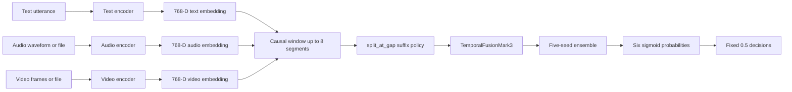

# EMORA Mark 3

## Multimodal Emotion Intelligence Pipeline

EMORA is a multimodal emotion-recognition system that combines text, audio,
and video signals to predict six emotions:

`happy`, `sad`, `anger`, `surprise`, `disgust`, and `fear`.

This branch contains the Mark 3 temporal-fusion implementation and its
validation-oriented MLOps tooling. Mark 1 and Mark 2 compatibility code
remains in the repository; the current documented production candidate is
Mark 3.

> **Scope note:** This README describes verified local engineering work. It
> does not claim test-set performance, production deployment, hosted CI
> success, or end-to-end remote artifact reproducibility.

## Problem and objectives

Emotion is expressed through multiple synchronized signals. A text-only,
audio-only, or vision-only model can miss context available in the other
modalities. EMORA is designed to:

- extract modality-specific representations from conversational segments;
- preserve causal temporal context without using future segments;
- combine the modalities with a learned temporal-fusion model;
- expose both API and frontend inference workflows;
- track validation experiments and model metadata;
- make operational assumptions explicit through health checks, CI, and
  drift-monitoring contracts.

## Current capabilities

### Implemented and locally verified

- Mark 3 causal temporal multimodal fusion model.
- Five-seed ensemble using seeds `42, 123, 456, 789, 2026`.
- `split_at_gap` causal-window policy with windows of up to eight segments.
- Fixed `0.5` decision threshold for all six emotions.
- FastAPI liveness, readiness, health, request validation, request IDs,
  request-size limits, configurable paths, CORS configuration, and safe
  error responses.
- Raw-media and structured Mark 3 manifest inference routes.
- React/Vite frontend with Mark 3 model and benchmark views.
- Local MLflow validation tracking with metrics, checkpoint hashes,
  evaluator hash, validation artifact hash, and a JSON validation report.
- Evidently input/prediction drift report generation from aggregate records
  without retaining raw media.
- GitHub Actions workflow definitions for backend checks, frontend builds,
  and repository safety checks.
- DVC repository metadata and a validation-only dry-run configuration.

### Partially implemented or locally scoped

- DVC has no configured remote. Validation data and checkpoints are present
  locally but are not yet shareable through DVC.
- DVC `status` reports changed dependencies because no lockfile/cache state
  has been established.
- CI workflows have been parsed and reviewed locally; no hosted GitHub
  Actions run is claimed here.
- The dependency files are useful CI/MLOps subsets, not a complete lockfile
  for every runtime dependency.
- Docker configuration exists, but Docker build/runtime verification is not
  claimed.

### Planned

- Select an approved artifact-storage provider and configure a credential-safe
  DVC remote.
- Version the permitted validation artifact and Mark 3 checkpoints with DVC.
- Establish a reviewed `dvc.lock` through an approved validation workflow.
- Publish a complete, compatible runtime dependency lock or environment
  specification.
- Add hosted CI evidence and a documented fresh-clone artifact-retrieval
  procedure.

## Architecture

Mark 3 operates on chronological multimodal segments:



The raw inference path validates a `SegmentManifest`, selects the causal
window ending at the requested segment, extracts one 768-dimensional
embedding per modality and segment, applies the existing `split_at_gap`
transform, and sends the resulting tensors through `TemporalFusionMark3`.
The ensemble averages the five member probabilities and applies the fixed
`0.5` policy.

The model configuration enforced by the inference loader is:

- input dimension: `768`;
- hidden dimension: `256`;
- attention heads: `8`;
- transformer layers: `2`;
- maximum sequence length: `8`;
- six output emotions.

The loader also verifies checkpoint identity, candidate name, seed, model
configuration, and deterministic-training metadata before serving.

## Technology stack

- Python 3.12 and PyTorch for Mark 3 inference.
- FastAPI and Uvicorn for the backend API.
- Transformers-based text/audio/video encoders in the raw-media pipeline.
- React 18, Vite, Tailwind CSS, GSAP, and Lucide React for the frontend.
- MLflow with a local SQLite tracking store for validation experiments.
- Evidently for aggregate input and prediction drift reports.
- DVC for planned dataset/checkpoint versioning and validation-stage metadata.
- GitHub Actions for backend, frontend, and repository safety workflows.

## Repository structure

```text
api/                    FastAPI application and serving configuration
src/models/              Mark 3 temporal-fusion model
src/encoders/            Text, audio, and video feature encoders
src/inference/           Mark 3 validation, manifest, and raw-media inference
scripts/                 Validation, manifest, MLflow, and experiment tooling
monitoring/              Privacy-preserving Evidently schema and report CLI
tests/                   Focused API, inference, startup, and monitoring tests
frontend/                React/Vite application
.github/workflows/       Backend, frontend, and safety workflows
dvc.yaml                Validation-only DVC stage declaration
.dvcignore              DVC exclusions for private/local artifacts
requirements-ci.txt     CI-oriented Python dependency subset
requirements-mlops.txt  MLflow, Evidently, DVC, and support dependencies
docs/mlops/README.md     Detailed MLOps workflow and verification record
```

Datasets, checkpoints, MLflow state, generated reports, virtual
environments, and frontend build output are intentionally excluded from
ordinary Git tracking.

## Environment setup

The commands below are Windows PowerShell examples. The current project was
verified with Python `3.12.10` in `.venv`.

```powershell
cd C:\SRUJAN\multimodal_ai
py -3.12 -m venv .venv
.\.venv\Scripts\Activate.ps1
python -m pip install --upgrade pip
python -m pip install -r requirements-ci.txt -r requirements-mlops.txt
cd frontend
npm ci
cd ..
```

The requirements files are not a complete application lockfile. A fresh
environment may require additional runtime packages used by the existing
Mark 1/Mark 2 compatibility paths and by the selected encoder backends.
Use the already verified project environment when reproducing the current
local results.

## Running the API and frontend

Start the backend from the repository root:

```powershell
.\.venv\Scripts\python.exe -m uvicorn api.main:app --host 127.0.0.1 --port 8001
```

Start the frontend in a second PowerShell window:

```powershell
cd C:\SRUJAN\multimodal_ai\frontend
npm run dev
```

The frontend defaults to `http://127.0.0.1:8001`. Set
`VITE_API_URL` when the backend is elsewhere. The API accepts
`EMORA_CORS_ORIGINS`, `EMORA_MARK3_CHECKPOINT_ROOT`,
`EMORA_MARK3_REPORT_PATH`, `EMORA_MAX_UPLOAD_BYTES`, and
`EMORA_MAX_REQUEST_BYTES`.

Mark 3 defaults to:

```text
checkpoints/mark3_step3/multiseed_20261027
reports/mark3_step3_final_20261027_151500.json
```

## API usage

Verified routes include:

| Method | Route | Purpose |
|---|---|---|
| `GET` | `/live` | Process liveness; does not require a loaded model. |
| `GET` | `/ready` | Mark 3 readiness; returns `503` until the ensemble is loaded. |
| `GET` | `/health` | Project/model health metadata. |
| `GET` | `/samples` | Mark 1 compatibility sample listing when its dataset is loaded. |
| `POST` | `/predict` | Mark 1 compatibility prediction using JSON. |
| `POST` | `/predict/mark3/raw` | Mark 3 raw multipart inference. |
| `POST` | `/predict/mark3/manifest` | Mark 3 structured temporal-manifest inference. |

Liveness and readiness checks:

```powershell
curl.exe http://127.0.0.1:8001/live
curl.exe http://127.0.0.1:8001/ready
curl.exe http://127.0.0.1:8001/health
```

Example readiness response:

```json
{
  "status": "ready",
  "model": "Mark 3",
  "candidate": "split_at_gap",
  "ensemble_size": 5,
  "threshold_policy": "fixed_0_5"
}
```

Raw Mark 3 inference uses multipart form fields. Video is required; text
and audio are optional at the API boundary, although the configured raw
pipeline requires usable audio and video sources for feature extraction:

```powershell
curl.exe -X POST http://127.0.0.1:8001/predict/mark3/raw `
  -F "text=I am excited about this result" `
  -F "audio=@C:\path\to\sample.wav" `
  -F "video=@C:\path\to\sample.mp4"
```

The response contains `success`, `model`, modality flags, per-emotion
probabilities and threshold decisions, `dominant_emotion`,
`predicted_emotions`, and pipeline metadata. Invalid or incomplete requests
return structured `4xx` responses. Raw media is not written to request
telemetry; endpoint exception-detail behavior should receive a final
production hardening pass before public deployment.

The manifest route accepts JSON shaped like:

```json
{
  "manifest": {
    "video_id": "conversation-001",
    "segments": [
      {
        "segment_number": 0,
        "segment_id": "conversation-001[0]",
        "text": "Hello",
        "video_path": "C:\\data\\segment.mp4",
        "audio_path": "C:\\data\\segment.wav"
      }
    ]
  },
  "target_segment_number": 0
}
```

The media paths must be accessible to the API process. No raw media is
retained by the monitoring workflow by default.

## Validation results

The latest recorded Mark 3 validation run is in local MLflow experiment
`EMORA-Mark3-Validation`:

- Run ID: `a4e76034035844d2b0d0cb89458b94b2`
- Macro-F1: `0.4629447664`
- Micro-F1: `0.5219874358`
- Subset accuracy: `0.2178828366`
- Decision policy: fixed `0.5`
- Validation windows: `973`
- Test split accessed: `false`

These are validation-only results from the fixed Mark 3 ensemble. They are
not test-set results and should not be interpreted as a production
generalization guarantee. The MLflow artifact includes per-emotion metrics,
checkpoint hashes, evaluator hash, validation artifact hash, and the JSON
validation report.

## MLOps and reproducibility

### DVC

DVC `3.66.1` is locally initialized. The validation-only stage is declared
in [dvc.yaml](dvc.yaml), and `dvc repro --dry` exits successfully without
executing the evaluator. `dvc status` exits successfully but reports changed
dependencies because no lockfile/cache state has been established.

No DVC remote is configured. The local validation tensor and checkpoints are
ignored by Git and are not currently represented by DVC pointer files.
Therefore collaborators cannot yet retrieve the required artifacts from a
fresh clone. Do not claim end-to-end DVC reproducibility until an approved
remote, DVC-tracked artifact references, and a reviewed lockfile exist.

### MLflow

Run validation tracking without test data:

```powershell
.\.venv\Scripts\python.exe scripts\log_mark3_validation_mlflow.py --device cpu
```

The wrapper rejects test-evaluation mode and records fixed-policy metrics,
per-emotion results, seeds, candidate, Git commit, evaluator hash,
validation artifact hash, and checkpoint hashes. Local MLflow state is
ignored and is not committed.

### Evidently

The monitoring CLI accepts aggregate records containing modality availability,
sequence length, gap indicators, and six probability columns. It does not
accept raw media and does not claim accuracy:

```powershell
.\.venv\Scripts\python.exe monitoring\evidently_report.py --synthetic-smoke
```

The smoke mode is explicitly synthetic and produces ignored local reports.
Production monitoring requires caller-provided reference/current aggregate
records and an approved retention policy.

### GitHub Actions

The repository contains workflows for:

- backend compilation and focused tests;
- frontend `npm ci` and production build;
- locked-test/forbidden-artifact safety checks and YAML validation.

The workflows are locally inspected and parsed. A hosted GitHub Actions run
has not been verified.

### Docker

Dockerfile and Compose configuration exist, but Docker build and runtime
health were not verified in the reviewed environment. Checkpoints, datasets,
MLflow state, reports, and credentials are kept outside the image
configuration. Docker is pending operational verification.

## Testing and verification

Previously verified local results:

```text
Focused API/inference/startup/monitoring suite: 32 passed,
5 warnings, 4 subtests passed.
Frontend npm run build: passed; 40 modules transformed.
Evidently synthetic smoke report: passed.
MLflow run/artifact retrieval: passed.
DVC YAML and workflow YAML parsing: passed.
git diff --check: exit 0.
```

Safe checks that do not run training or test evaluation:

```powershell
cd C:\SRUJAN\multimodal_ai
.\.venv\Scripts\python.exe -m pytest tests\test_mlops_api_contract.py tests\test_mlops_monitoring.py -q
.\.venv\Scripts\python.exe -m dvc status
.\.venv\Scripts\python.exe -m dvc repro --dry
git --no-pager diff --check
```

Do not run commands containing `--evaluate-test`. The locked test split is
outside the permitted validation workflow.

## Limitations and roadmap

- Add approved remote storage and DVC pointers for validation data and
  checkpoints.
- Establish and review a DVC lockfile without executing test evaluation.
- Provide a complete runtime dependency lock for fresh-clone setup.
- Verify the workflows on GitHub Actions.
- Validate Docker only when the Docker toolchain and runtime environment are
  available.
- Add a production monitoring data-retention and alerting policy.
- Keep accuracy claims separate from drift signals unless ground-truth
  labels and a valid evaluation protocol are available.

## Security and data handling

- Do not commit raw datasets, checkpoints, MLflow databases, caches,
  virtual environments, secrets, `.env` files, or generated reports.
- Configure CORS through environment variables rather than hard-coding
  deployment-specific origins.
- Request IDs and timing are logged without raw media payloads.
- Upload and request size limits are configurable.
- Use approved artifact storage and credentials outside Git.
- Treat media paths and uploaded content as sensitive inputs.

## Contributing and license

Contributions should preserve the Mark 3 architecture, five ensemble seeds,
fixed `0.5` threshold policy, validation-only safety contract, and existing
API response compatibility. Add focused tests for behavior changes and
avoid committing generated or private artifacts.

No repository license file was found. Licensing is pending a project-owner
decision.
