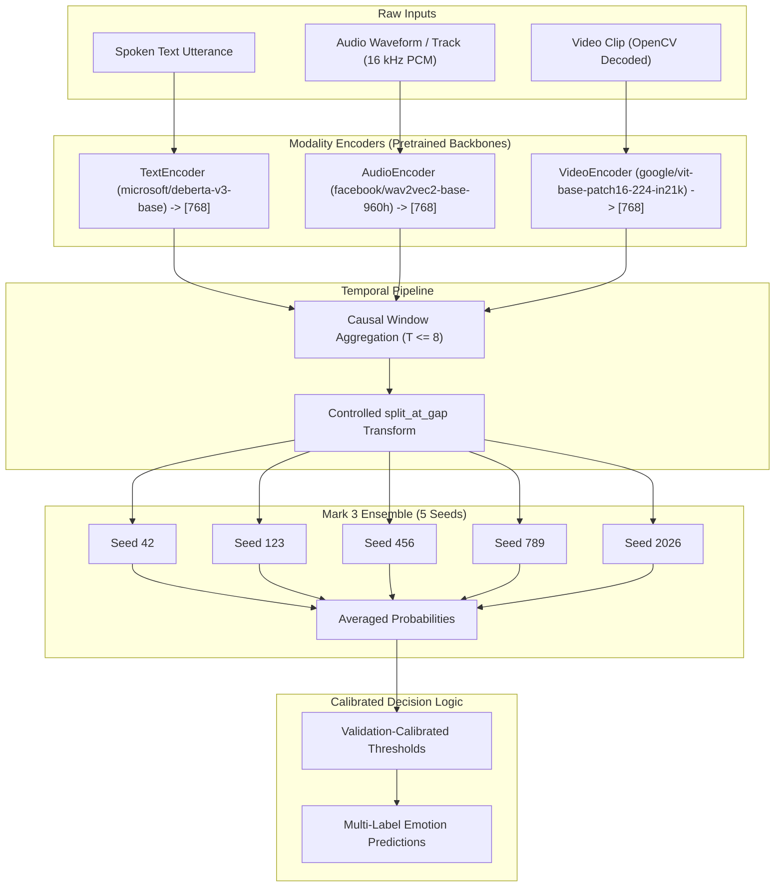

# EMORA Mark 3 — Raw-Input Inference Pipeline Documentation

## 1. System Overview

EMORA Mark 3 is the temporal multimodal emotion recognition system for aligned conversational utterances. While earlier milestones operated on precomputed feature embeddings, the Mark 3 raw-input inference pipeline enables real-time, end-to-end classification directly from raw text utterances, audio recordings, and video clips.



---

## 2. Modality Encoder Specifications

All encoder wrappers in `src/encoders/` replicate the exact training-time extraction protocols defined in `scripts/extract_mark2_features.py`:

### 2.1 Text Encoder (`src/encoders/text_encoder.py`)
- **Backbone**: `microsoft/deberta-v3-base` (183.8M parameters)
- **Tokenization**: `max_length=256`, `truncation=True`, `padding=True`
- **Pooling**: Attention-mask-aware mean pooling with `clamp(min=1)`:
  $$\mathbf{e}_{\text{text}} = \frac{\sum_{i=1}^L \mathbf{h}_i \cdot m_i}{\max(1, \sum_{i=1}^L m_i)}$$
- **Empty / Non-string Handling**: Deterministically returns $\mathbf{0}_{768}$
- **Output**: Shape `[768]`, float32, CPU

### 2.2 Audio Encoder (`src/encoders/audio_encoder.py`)
- **Backbone**: `facebook/wav2vec2-base-960h` (94.4M parameters)
- **Ingestion**: FFmpeg extraction to 16 kHz mono float32 little-endian PCM (`-ac 1 -ar 16000 -f f32le -`)
- **Normalization**: No artificial peak or loudness normalization applied (matches training distribution)
- **Feature Extraction**: `AutoProcessor(audio, sampling_rate=16000, padding=True)`
- **Pooling**: Mean pooling across sequence dimension: $\mathbf{e}_{\text{audio}} = \frac{1}{T} \sum_{t=1}^T \mathbf{h}_t$
- **Empty Audio Handling**: Returns $\mathbf{0}_{768}$
- **Output**: Shape `[768]`, float32, CPU

### 2.3 Video Encoder (`src/encoders/video_encoder.py`)
- **Backbone**: `google/vit-base-patch16-224-in21k` (86.4M parameters)
- **Frame Sampling**: 8 uniformly spaced frames sampled across the video or timestamp window:
  $$\text{indices} = \text{round}\left(\text{linspace}(0, N_{\text{total}} - 1, 8)\right)$$
- **Color Conversion**: OpenCV BGR $\to$ RGB
- **Image Processing**: `AutoImageProcessor` standard ViT normalization (224x224 resize, ImageNet normalization)
- **Pooling**: CLS token extraction followed by temporal mean across the 8 frames:
  $$\mathbf{e}_{\text{video}} = \frac{1}{8} \sum_{f=1}^8 \mathbf{h}_{f, \text{CLS}}$$
- **Output**: Shape `[768]`, float32, CPU

---

## 3. Temporal Pipeline & `split_at_gap`

Mark 3 models temporal emotional dynamics across multi-utterance conversation segments:

1. **Causal Window Selection**: Given a conversational session, up to 8 preceding contiguous or non-contiguous segments are collected leading up to the target segment:
   $$\mathcal{W} = (s_{k-T+1}, \dots, s_k), \quad 1 \le T \le 8$$
2. **Controlled Split-at-Gap Transform**: If numbering gaps occur (i.e. $s_i - s_{i-1} > 1$), only the contiguous suffix ending at the target segment is retained. This matches the best candidate configuration (`split_at_gap`) selected during controlled Step 3 experiments.

---

## 4. Frozen Ensemble & Calibrated Thresholds

The model ensemble consists of 5 deterministic checkpoints trained across distinct random seeds:

| Seed | Checkpoint Path | Epoch | Val Macro F1 |
|:---:|---|:---:|:---:|
| **42** | `checkpoints/mark3_step3/multiseed_20261027/seed_42/split_at_gap/best.pt` | 6 | 0.4394 |
| **123** | `checkpoints/mark3_step3/multiseed_20261027/seed_123/split_at_gap/best.pt` | 10 | 0.4549 |
| **456** | `checkpoints/mark3_step3/multiseed_20261027/seed_456/split_at_gap/best.pt` | 4 | 0.4509 |
| **789** | `checkpoints/mark3_step3/multiseed_20261027/seed_789/split_at_gap/best.pt` | 6 | 0.4485 |
| **2026** | `checkpoints/mark3_step3/multiseed_20261027/seed_2026/split_at_gap/best.pt` | 3 | 0.4616 |

### Frozen Validation-Calibrated Decision Thresholds
Read directly from `reports/mark3_step3_final_20261027_151500.json`:

| Emotion | Calibrated Threshold | Interpretation |
|---|:---:|---|
| **Happy** | `0.3200` | High-recall positive affect trigger |
| **Sad** | `0.4300` | Calibrated melancholic detector |
| **Anger** | `0.4300` | Hostile prosody detector |
| **Surprise** | `0.4100` | Low-support calibrated detector |
| **Disgust** | `0.5200` | High-precision revulsion trigger |
| **Fear** | `0.4300` | Low-support distress detector |

---

## 5. Python API Usage

### Single-Segment Inference
```python
from src.inference.mark3_raw import Mark3RawInference

pipeline = Mark3RawInference()

# Classify a standalone raw video clip
prediction = pipeline.predict_single_segment(
    text="I am absolutely thrilled by this progress!",
    video_path="path/to/utterance.mp4",
)

print("Dominant emotion:", max(prediction.probabilities, key=prediction.probabilities.get))
print("Detected emotions:", prediction.predicted_emotions)
print("Probabilities:", prediction.probabilities)
```

### Conversational Manifest Inference
```python
from src.inference.mark3_raw import Mark3RawInference
from src.inference.segment_manifest import SegmentInput, SegmentManifest

pipeline = Mark3RawInference()

# Multi-utterance dialogue
manifest = SegmentManifest(
    video_id="conversation_session_01",
    segments=[
        SegmentInput(segment_number=0, text="Good morning.", media_path="turn_0.mp4"),
        SegmentInput(segment_number=1, text="Did you hear the news?", media_path="turn_1.mp4"),
        SegmentInput(segment_number=2, text="I can't believe it!", media_path="turn_2.mp4"),
    ]
)

prediction = pipeline.predict_manifest(manifest, target_segment_number=2)
print("Turn 2 Affect:", prediction.predicted_emotions)
print("Context used:", prediction.metadata["used_segment_numbers"])
```

---

## 6. REST API Endpoints

The FastAPI server (`api/main.py`) exposes Mark 3 inference:

### `POST /predict/mark3/raw`
- **Content-Type**: `multipart/form-data`
- **Fields**:
  - `text`: optional spoken utterance string
  - `video`: video clip (`.mp4`, `.mov`, `.avi`, `.webm`, `.mkv`)
  - `audio`: optional standalone audio file (extracted from video if omitted)
- **Response**:
```json
{
  "success": true,
  "model": "Mark 3",
  "modalities": {
    "text": true,
    "audio": true,
    "video": true
  },
  "emotions": {
    "happy": {"probability": 0.8123, "threshold": 0.3200, "detected": true},
    "sad": {"probability": 0.0412, "threshold": 0.4300, "detected": false},
    "anger": {"probability": 0.0521, "threshold": 0.4300, "detected": false},
    "surprise": {"probability": 0.1254, "threshold": 0.4100, "detected": false},
    "disgust": {"probability": 0.0102, "threshold": 0.5200, "detected": false},
    "fear": {"probability": 0.0189, "threshold": 0.4300, "detected": false}
  },
  "dominant_emotion": "happy",
  "predicted_emotions": ["happy"],
  "metadata": {
    "raw_media_supported": true,
    "raw_sequence_length": 1,
    "split_sequence_length": 1,
    "ensemble_size": 5
  }
}
```

### `POST /predict/mark3/manifest`
- **Content-Type**: `application/json`
- **Canonical body**: An object containing a serialized `SegmentManifest` under
  `manifest`, plus an optional `target_segment_number`. The target defaults to
  the final segment when omitted. For compatibility, the endpoint also accepts
  the legacy unwrapped `SegmentManifest` object; its optional
  `target_segment_number` is honored.
- **Example Payload**:
```json
{
  "manifest": {
    "video_id": "demo_session",
    "segments": [
      {
        "segment_number": 0,
        "start_time": 0.0,
        "end_time": 2.5,
        "text": "Hello there.",
        "media_path": "frontend/public/samples/sample_video.mp4"
      },
      {
        "segment_number": 1,
        "start_time": 2.5,
        "end_time": 5.0,
        "text": "Everything is going according to plan.",
        "media_path": "frontend/public/samples/sample_video.mp4"
      }
    ]
  },
  "target_segment_number": 1
}
```

---

## 7. Concurrency Protection & Operational Safeguards

To prevent GPU Out-of-Memory (OOM) errors and uncontrolled thread thrashing during heavy neural network forward passes, a bounded concurrency guard protects raw-media inference endpoints (`POST /predict/raw`, `POST /predict/mark3/raw`, and `POST /predict/mark3/manifest`):

- **Concurrency Mechanism**: Async bounded permit manager (`get_inference_semaphore()`) executed inside an `async with inference_guard():` context.
- **Default Limit**: `1` concurrent inference request (configured via `EMORA_MAX_CONCURRENT_INFERENCE` environment variable).
- **Queuing & Overload Timeout**: Incoming requests acquire the permit with a default timeout of `30.0` seconds (configured via `EMORA_INFERENCE_TIMEOUT_SECONDS`). If the queue wait exceeds the timeout, the API rejects the request immediately with `HTTP 503 Service Unavailable` (`"Server is busy processing other inference requests. Please retry shortly."`).
- **Permit Safety**: The permit is managed in a strict `try ... finally` block, ensuring permits are reliably released upon completion, validation exceptions, model errors, client disconnections, or cancellations.
- **Health Endpoint Isolation & Event-Loop Responsiveness**: Non-inference endpoints like `GET /health` do not acquire the inference lock. Synchronous CPU/GPU encoder and model forward passes are offloaded to worker threads via `asyncio.to_thread`, ensuring the `asyncio` event loop remains unblocked and immediately responsive to health checks and other non-inference requests throughout the duration of inference.
- **Upload & Media Limits**:
  - Maximum upload file size: 50 MiB (`MAX_UPLOAD_BYTES = 50 * 1024 * 1024`).
  - Media duration limit: Maximum 300 seconds / 5 minutes (`MAX_MEDIA_DURATION_SECONDS = 300.0`).
  - FFmpeg subprocess timeout: 30 seconds (`FFMPEG_TIMEOUT_SECONDS = 30.0`).
  - Temporary files are created in OS temp space with random suffixes and guaranteed deletion in `finally:` blocks.

---

## 8. Running the Application Locally

### Starting the Backend API
From the project root:
```powershell
.\.venv\Scripts\python.exe -m uvicorn api.main:app --host 127.0.0.1 --port 8000
```
*(Use `--port 8001` or any custom port if port 8000 is occupied).*

### Starting the Frontend Development Server
From the project root:
```powershell
npm --prefix frontend run dev
```
The frontend UI is accessible at `http://localhost:5173`.

### Building the Frontend Production Bundle
```powershell
npm --prefix frontend run build
```

---

## 9. Verification & Test Suite

Run the full backend test suite:
```powershell
.\.venv\Scripts\python.exe -m unittest discover -s tests -p "test_*.py" -v
```

All 60 tests across encoders, temporal aggregation, manifests, ensemble inference, Mark 2/Mark 3 REST APIs, frame compatibility, and concurrency protection pass.

Verify clean Git tree without whitespace issues:
```powershell
git diff --check
```

---

## 10. Known Limitations & Engineering Status

1. **Missing Mark 1 Dataset**:
   - `data/processed/aligned_mark1/COVAREP_aligned.csd` is not present in the workspace.
   - The API gracefully logs a warning on startup and marks `dataset_loaded: false`.
   - Mark 1 dataset-dependent endpoints (`GET /samples`, `POST /predict`) return `HTTP 503 Service Unavailable` with a clear explanation.
   - Mark 2 and Mark 3 raw-media inference endpoints operate completely independently of the Mark 1 dataset and remain fully functional.

2. **Unresolved Raw-Media Training Feature Parity**:
   - The original raw CMU-MOSEI source video files (`data/raw/`) are not bundled in this repository.
   - While the raw-media encoders reproduce the exact tokenization, sampling, normalization, and pooling logic of `scripts/extract_mark2_features.py`, exact numerical bit-for-bit parity against the historical training features cannot be verified without the original source recordings.
   - Verified via unit tests, deterministic mocks, and live inference using bundled demo media (`frontend/public/samples/sample_video.mp4` and `sample_audio.wav`).

3. **Production Readiness Notice**:
   - Passing unit and integration tests with deterministic mocks validates code correctness, API contracts, and concurrency safety.
   - It does not constitute end-to-end multi-tenant load testing or real-world GPU saturation verification. In production deployments, multi-worker process topologies, GPU memory pinning, and reverse-proxy rate limiting (e.g. NGINX) should be configured.
